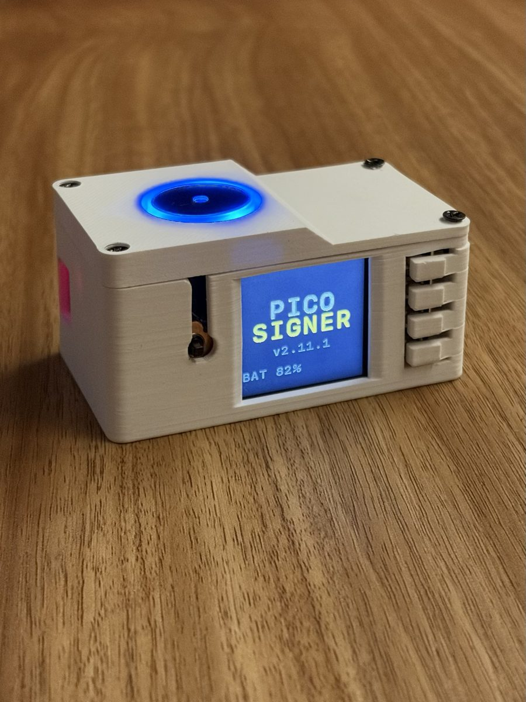
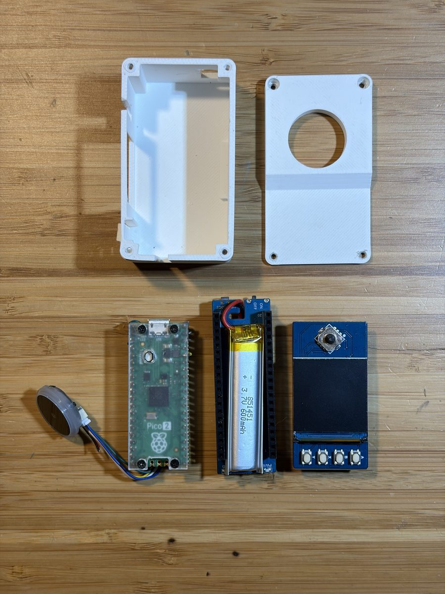
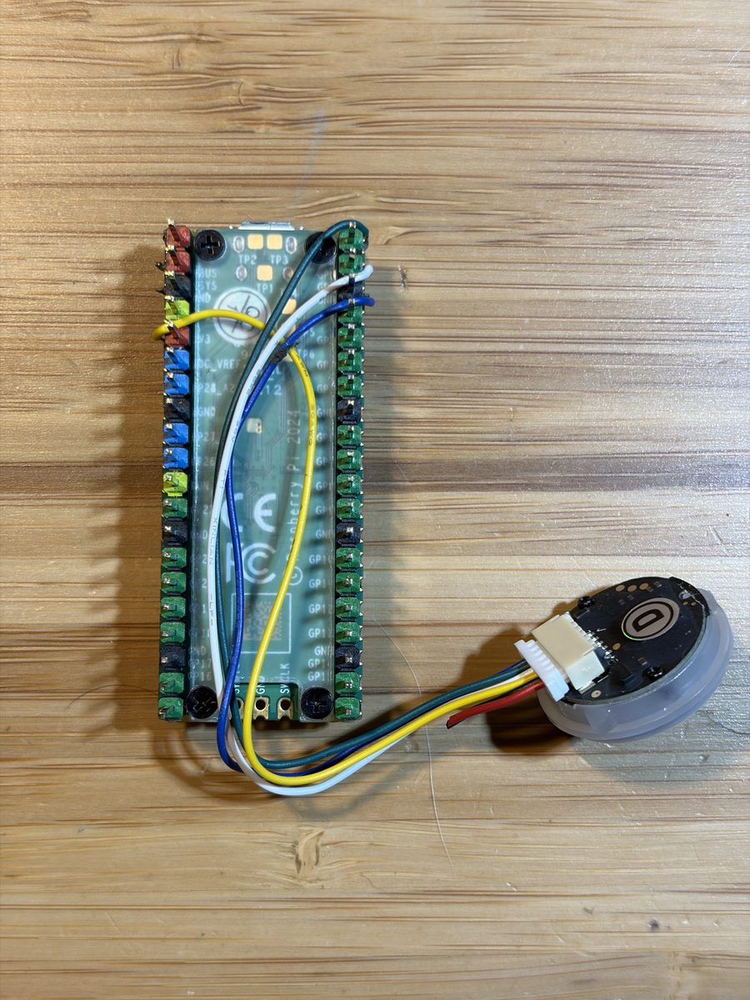
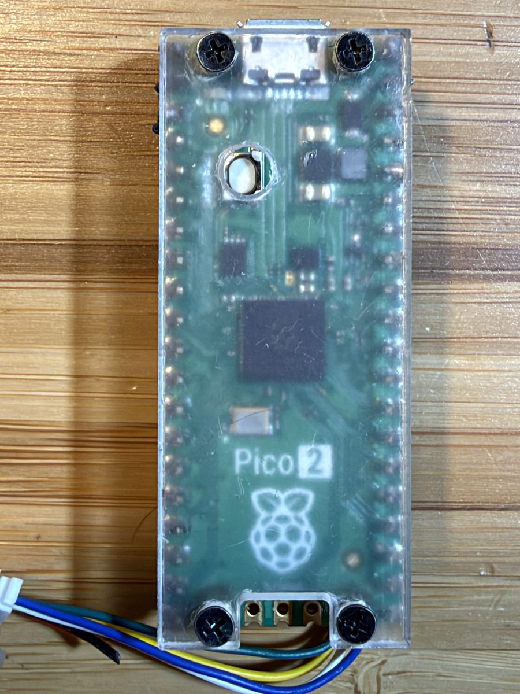

# Pico Signer

An air-gapped Bitcoin signing device built on a **Raspberry Pi Pico 2** running MicroPython.
No radio, no stored secrets: the seed lives in RAM only and is gone when power is cut.

<p align="center"><br>
<sub>The device in its case (photo taken at an earlier version, v2.11.1)</sub></p>

> ⚠️ **Hobby project — not audited.** Elliptic-curve math uses **libsecp256k1** (Bitcoin Core's
> library) when the custom firmware is flashed, but BIP39, BIP32, PSBT parsing/review and the UI
> are written from scratch in Python and have only been checked against reference implementations
> in the test suite. Do not trust it with funds you cannot afford to lose.
> Outside review is welcome — see [SECURITY_REVIEW.md](SECURITY_REVIEW.md).

## Hardware

| Part | Notes |
|---|---|
| Raspberry Pi Pico 2 (RP2350) | no WiFi / Bluetooth on the chip |
| Waveshare Pico-LCD-1.3 | ST7789 240×240, 4 buttons + 5-way joystick |
| Waveshare Pico-UPS-B + 600 mAh LiPo | INA219 on I2C1 (GP6/GP7) for battery % |
| Waveshare Barcode Scanner Module (D) | UART0 (scanner TX → GP1, RX → GP0) · **3.3 V only** |

<p align="center">



<br><sub>Left: all parts and the case · Middle: scanner wired to the Pico 2 (power, ground, UART TX/RX) · Right: Pico 2 under a clear cover</sub>
</p>

## Features

- **New seed from dice only** (12 or 24 words) — never uses the chip's random number generator
- Load seed by typing words or scanning **SeedQR** (Standard and Compact)
- Optional BIP39 passphrase · BIP84 accounts (`m/84h/0h/<n>h`)
- **Export xpub** as BBQr (Coldcard Generic JSON)
- **Sign PSBT** scanned as BBQr, with a review screen for every output · signed PSBT shown back as BBQr
- **Verify receive address** — checks that an address shown by your online wallet really belongs to this seed
- Deterministic ECDSA nonces (RFC6979) and low-S signatures · every signature is verified before it leaves the device
- Show SeedQR backup on screen (for copying by hand)

## Security model and known limits

- **Stateless:** the app never writes the seed to flash (the only file it writes is `crash.txt` on an exception).
- **USB data is off from power-on.** `boot.py` runs before USB starts and sets up a USB device with no interfaces, so a computer never sees a serial port/REPL; power still flows for charging. Hold **B** while powering on to get USB (and the REPL) back for development/updates — that needs physical access. If the device was started with B held, USB is switched off again as soon as you start entering a real seed.
- **PSBT checks** (refuse = nothing is signed):
  - input amounts are trusted only from the full previous transaction (`non_witness_utxo`) whose hash matches the txid, and must match `witness_utxo` byte for byte (CVE-2020-14199)
  - fee above 10 % of total outputs, duplicate inputs, outputs above inputs, inputs from another account
  - change is hidden from the review only if it is a `p2wpkh` output of this seed on the selected account's BIP84 path, within a bounded index; anything else is shown as a destination
- **No PIN:** whoever holds the device while a seed is loaded can use it.
- **No secure boot:** someone with physical access can reflash the device. The firmware hash (below) covers MicroPython and the C modules only; the app's `.py` files live on the filesystem.
- The scanner's light cannot be switched off in software and it draws most of the power (~120 of ~133 mA).

## Firmware

Custom MicroPython build with two C modules (`firmware/usermods.cmake`):

- `usermod_sha512/` exposes the SHA-512 already linked into the RP2 port (mbedtls) — BIP39 seed derivation goes from ~7 min to ~11 s.
- `usermod_secp256k1/` is a thin bridge to **libsecp256k1 v0.8.0** (no curve math of its own). Small precomputed tables (`ECMULT_WINDOW_SIZE=4`, comb 11×6 = 22 KB), static context, no context randomization (the device never uses its RNG). On the Pico: sign 9 ms vs 614 ms in Python.

Without the modules the app still works, just slowly (pure-Python fallbacks).

```sh
git clone --depth 1 --branch v1.29.0 https://github.com/micropython/micropython
git clone --depth 1 --branch v0.8.0  https://github.com/bitcoin-core/secp256k1   # commit 6e2c8bc4…
cd micropython && git apply /path/to/firmware/pico/micropython-rp2.patch      # -Wno-error=array-bounds
make -C mpy-cross
make -C ports/rp2 BOARD=RPI_PICO2 submodules
SECP256K1_DIR=/path/to/secp256k1 make -C ports/rp2 BOARD=RPI_PICO2 USER_C_MODULES=/path/to/firmware/usermods.cmake
```

Flash `ports/rp2/build-RPI_PICO2/firmware.uf2` (hold BOOTSEL while plugging in, then copy the file).
The build is reproducible on the same toolchain (Arm GNU Toolchain 15.3.Rel2): the author's build has
SHA256 `830427af1d8349239d72e94806109fb7c3d1ffc76b35e7fdad41d6b1abbb2a0a` (built 2026-10-13; the date is part of the image, so a rebuild on another day gives a different hash).

## Install the app

```sh
pip install mpremote
for f in src/*.py src/english.txt main.py; do mpremote cp "$f" :"$(basename "$f")"; done
```

Fonts: `src/lcd.py` uses MicroPython's built-in 8×8 font. A nicer bitmap font can be dropped in as `font_sfmono.py` (same format), but none is included here for licensing reasons.

## Tests

Tests run on a normal computer with CPython:

```sh
./run_tests.sh
```

- `tests/interop/` cross-checks against JavaScript reference libraries (bitcoinjs, bip39, qrcode). They run only when `node` is installed (`cd tests/interop && npm ci`).
- `tests/mp_secp256k1c_crosscheck.py` compares libsecp256k1 with the pure-Python code byte for byte. It needs a MicroPython **unix** build with the module: `make -C ports/unix MICROPY_PY_FFI=0 USER_C_MODULES=/path/to/firmware` (set `MP_UNIX` to the binary).

Code comments are mostly in Thai.

## License

MIT — see [LICENSE](LICENSE).
